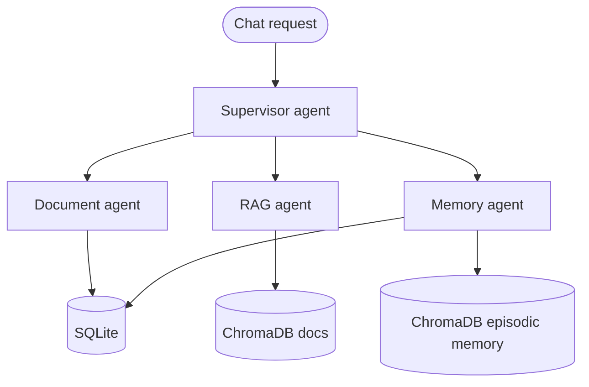

# AgenticRAG

A Django backend that uses LangGraph to answer questions from user documents, a shared PDF knowledge base, and per-user episodic memory. Django exposes an OpenAI-compatible chat API, and a remote vLLM server provides Qwen chat and embeddings.

## Architecture



| Agent | Role | Tools |
| --- | --- | --- |
| Supervisor | Answers directly or routes requests to the relevant agent. Its prompt delegates memory updates when the user shares significant facts or closes the conversation. | |
| Document agent | Searches user-owned documents in SQLite. Permit integration is in progress. | `search_query_documents`, `get_document` |
| RAG agent | Retrieves relevant passages from the shared PDF knowledge base. | `retriever_tool` |
| Memory agent | Searches, saves, updates, and deletes per-user episodic facts. | `search_episodic_memory`, `add_episodic_memory`, `update_episodic_memory`, `delete_episodic_memory` |

## Storage

- **Conversation history** uses LangGraph checkpoints keyed by Django user ID. Set `REDIS_URI` to persist checkpoints in Redis across Django restarts. With an empty `REDIS_URI`, history lasts for the lifetime of the Django process.
- **SQLite** at `agenticRag/db.sqlite3` stores Django users, documents, and episodic memory records.
- **PDF retrieval** uses the `docs` collection in `agenticRag/chroma_db_docs`. Set `pdf_dir` in [the PDF indexer](agenticRag/ai/indexer.py) to a directory available on your machine before indexing new PDFs.
- **Episodic recall** uses the `episodic_memory` collection in `agenticRag/chroma_db_episodic_memory`. It indexes facts alongside their Django record IDs and filters searches by owner.

Both Chroma stores use Qwen embeddings. Start with empty Chroma stores when switching from Gemini because the existing vectors use a different embedding model. The Qwen switch applies to future PDF indexing and memory writes. Existing data was never backfilled with Qwen.

## Local development

Install uv and run these commands from the repository root. The project uses Python 3.12 by default. [Install uv](https://docs.astral.sh/uv/getting-started/installation/)

```bash
uv sync --locked
uv run --locked python agenticRag/manage.py check
uv run --locked python agenticRag/manage.py migrate
uv run --locked python agenticRag/manage.py runserver
```

Create a local Django user with `uv run --locked python agenticRag/manage.py createsuperuser`. The chat API uses Django session cookies. For a frontend served from the same origin as Django, keep cookies enabled and use this flow.

1. Call `GET /v1/session` and read `csrf_token` from the JSON response.
2. Call `POST /v1/session` with JSON `username` and `password` and send the token in the `X-CSRFToken` header. Save the new `csrf_token` from the response because Django rotates it at login.
3. Send that token in `X-CSRFToken` when posting messages to `/v1/chat/completions` or signing out with `DELETE /v1/session`.

`GET /v1/` is Django's health endpoint. `GET /v1` redirects to it. `GET /v1/models` lists the public model ID `agentic-rag`.

`POST /v1/chat/completions` accepts `messages`, an optional `model` set to `agentic-rag`, and an optional `stream` set to `false`. Messages can use `user`, `assistant`, `system`, or `developer` roles with a text string or an array of `text` parts. Read the completed answer at `choices[0].message.content`. The response includes token usage when the chat models report it. Streaming and other generation options are currently unsupported.

The default sync includes Jupyter. Launch it with `uv run --locked jupyter notebook notebook/`. For a runtime-only environment, use `uv sync --locked --no-dev` and pass `--no-dev` to `uv run` as well.

## Remote vLLM configuration

Set these values in the Git-ignored `agenticRag/.env` next to `manage.py`. Both services run on the same remote GPU server. Choose the server address reachable from the Django host.

| Variable | Value |
| --- | --- |
| `VLLM_BASE_URL` | Remote chat service base URL on port `8123`, ending in `/v1` |
| `VLLM_MODEL` | Model ID served by the `vllm` service in `docker-compose.yaml` |
| `VLLM_EMBEDDINGS_BASE_URL` | Remote embedding service base URL on port `8124`, ending in `/v1` |
| `VLLM_EMBEDDINGS_MODEL` | `Qwen/Qwen3-Embedding-0.6B` |

The embedding client calls `/v1/embeddings` without an API key. The chat client uses the OpenAI SDK. If the SDK requires `OPENAI_API_KEY` during initialization, a local placeholder is sufficient for an unauthenticated vLLM chat endpoint.

Run the Compose stack on the GPU server. It starts the embedding service after chat passes its health check. From the Django host, check `/v1/models` on ports `8123` and `8124` to confirm each remote model is visible. [Compose configuration](docker-compose.yaml)

## Redis short-term memory

Set the remote Redis endpoint in Django's Git-ignored `agenticRag/.env`. Use the server address reachable from the Django host and replace the password placeholder with the server's Redis password. Percent-encode any reserved characters in the password.

```dotenv
REDIS_URI=redis://:YOUR_PASSWORD@10.140.173.65:6379/0
REDIS_CHECKPOINT_TTL_MINUTES=1440
```

Direct connections require a Redis endpoint on the GPU server's private interface. The checked-in Compose service publishes port `6379` on the GPU server's loopback interface. Django initializes the checkpoint indexes at startup when the configured endpoint is reachable.

The optional TTL setting defaults to 24 hours. LangGraph refreshes the TTL on checkpoints it reads.

## Project structure

```text
AgenticRAG/
├── agenticRag/
│   ├── agenticRag/           # Django settings, routes, and API
│   ├── ai/                   # Agents, model clients, indexing, and storage
│   ├── documents/            # Django models and migrations
│   └── manage.py
├── notebook/                 # Django development notebooks
├── docker-compose.yaml       # Remote vLLM and Redis stack
├── pyproject.toml            # Python dependencies
├── uv.lock                   # Locked dependency versions
└── AGENTS.md                 # Repository guide for coding sessions
```
