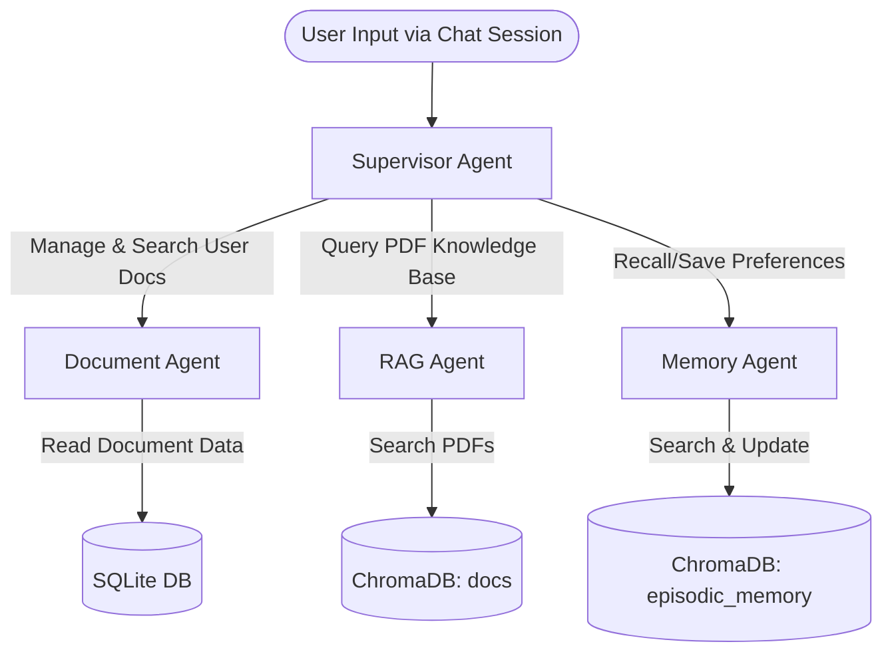

# Agentic RAG Chatbot — Enterprise Document Search & Memory

An advanced **Agentic RAG** backend system built on **Django** + **LangGraph** + **LangChain**. Features a multi-agent cognitive architecture with dynamic episodic memory, tailored for interacting with users, searching specific user documents, querying static PDF knowledge bases, and maintaining personalized long-term memory.

---

## 🧠 Multi-Agent Architecture



### Agents

| Agent | Role | Tools |
|---|---|---|
| **Supervisor Agent** | Interacts directly with the user and dynamically routes requests to the appropriate sub-agent based on the context of the conversation. Detects session closure to trigger memorization. | N/A (Router) |
| **Document Agent** | Manages static user documents and answers user queries by searching their owned/uploaded documents in the relational database. | `search_query_documents`, `get_document` |
| **RAG Agent** | Dedicated agent to query and retrieve information from the global PDF Knowledge Base (e.g., Stock Market Performance 2024). | `retriever_tool` |
| **Memory Agent** | Manages dynamic long-term episodic memory to personalize the experience based on user preferences. | `search_episodic_memory`, `add_episodic_memory`, `update_episodic_memory`, `delete_episodic_memory` |

---

## 💾 Memory & Knowledge Systems

### Short-Term Conversational Memory (Redis)
Per-session chat history and intermediate agent steps are preserved dynamically using the **LangGraph Redis Checkpointer**.
- The system automatically uses a local Redis instance on port `6379`.

### Dual Vector Database Architecture (ChromaDB)
The system utilizes two isolated ChromaDB vector stores, embedded via Gemini:

**1. PDF Knowledge Base (`chroma_db_stock`):**
- **Purpose**: Global RAG search for static documents loaded from a directory (e.g., `d:\pfe_yasmine\data`).
- **Usage**: The RAG Agent uses the `retriever_tool` to fetch context for answering user questions about the specific knowledge base.

**2. Episodic Memory (`chroma_db`):**
- **Purpose**: Per-user long-term dynamic memory stored in the `episodic_memory` collection.
- **Retrieval Phase**: The supervisor routes to the Memory Agent to explicitly search ChromaDB using `search_episodic_memory` to provide personalized answers based on historical preferences.
- **Save Trigger**: When the session is closing or the conversation contains significant new facts, the Supervisor routes to the Memory Agent. The Memory Agent follows a strict deduplication workflow to summarize the recent conversation, searching first, then utilizing `add_episodic_memory`, `update_episodic_memory`, or `delete_episodic_memory`.

---

## ⚙️ Environment Setup

To run the application, configure your `.env` file at the root of the project with the following keys:

```dotenv
# Google API (For Embeddings)
GOOGLE_API_KEY="your-google-api-key"

# LLM Provider (OpenRouter/Gemma)
OPENROUTER_API_KEY="your-openrouter-api-key"
```

*Ensure a local Redis server is running on port `6379` via Docker:*
```bash
docker run -d --name redis-demo -p 6379:6379 redis
```

---

## 📁 Project Structure

```
agentic_rag/
├── agenticRag/
│   ├── ai/
│   │   ├── agents.py                 # Document, Memory, and RAG agents setup
│   │   ├── supervisor.py             # LangGraph Supervisor implementation
│   │   ├── llm.py                    # LLM OpenRouter & Embedding configuration
│   │   ├── vectorstore.py            # ChromaDB episodic memory setup
│   │   ├── retriever.py              # PDF chunking and ChromaDB knowledge base setup
│   │   ├── tools_documents.py        # Tools for searching and reading user documents
│   │   ├── tools_memory.py           # Tools for reading/writing episodic facts
│   │   ├── tools_retriever.py        # Retriever tool for the RAG agent
│   │   └── short_term_mem.py         # Redis checkpointer setup
│   ├── documents/
│   │   └── models.py                 # Django ORM Models (Document, EpisodicMemory)
│   └── agenticRag/                   # Core Django project settings
└── README.md
```
